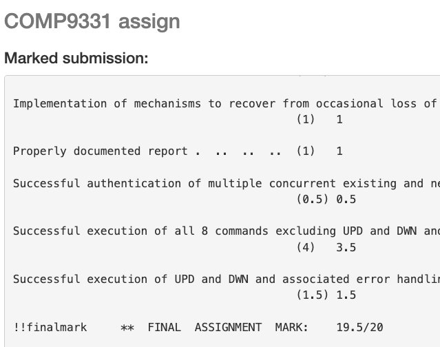

# COMP9331 Computer Networks and Applications: UDP/TCP Discussion Forum

**Course:** COMP9331 Computer Networks and Applications, Term 1 2025  
**Author:** Yining Liu (z546010)  
**Project:** Client-server discussion forum

## Table of Contents

- [Overview](#overview)
- [Key Features](#key-features)
- [Application Protocol](#application-protocol)
- [Command Reference](#command-reference)
- [Project Structure](#project-structure)
- [How to Run](#how-to-run)
- [Assignment Feedback](#assignment-feedback)
- [Security Note](#security-note)

## Overview

This project implements a command-line discussion forum using a custom application-layer protocol. Clients send commands to a multithreaded server over UDP. File uploads and downloads use TCP connections negotiated through a UDP handshake.

The client and server are implemented in Python using standard-library networking and threading modules. No third-party Python packages are required.

## Key Features

- User login and registration with credential validation.
- Forum thread creation, listing, reading, and removal.
- Message posting, editing, and deletion.
- File upload and download between clients and the server.
- Sequence numbers, acknowledgements, timeouts, and retries to handle occasional UDP packet loss.
- Duplicate-request detection to avoid repeating commands when acknowledgements are retransmitted.
- Concurrent request handling with locks protecting shared server state and files.
- Filename conflict handling for uploads and downloads.

## Application Protocol

Client requests follow this format:

```text
username/middle_gap/COMMAND ARGS.../FORUM
```

The server responds with an acknowledgement containing the request sequence number:

```text
ACK|<sequence number>|<response>
```

The client waits for an acknowledgement and retries a request up to five times if a response is not received. The server tracks processed sequence numbers and returns a duplicate marker for repeated requests.

Forum commands use UDP. `UPD` and `DWN` first negotiate a transfer through UDP, then send the file over TCP.

## Command Reference

| Command | Purpose | Example syntax |
|---|---|---|
| `CRT` | Create a discussion thread | `CRT thread1` |
| `MSG` | Post a message | `MSG thread1 Hello everyone` |
| `DLT` | Delete one of your messages | `DLT thread1 1` |
| `EDT` | Edit one of your messages | `EDT thread1 1 Updated message` |
| `LST` | List active threads | `LST` |
| `RDT` | Read a thread | `RDT thread1` |
| `RMV` | Remove a thread you created | `RMV thread1` |
| `UPD` | Upload a file to a thread | `UPD thread1 notes.txt` |
| `DWN` | Download a file from a thread | `DWN thread1 notes.txt` |
| `XIT` | Log out and exit | `XIT` |

## Project Structure

```text
README.md
.gitignore
report.pdf
feedback.PNG
client_9331/
└── client.py
server_9331/
└── server.py
```

The server creates `credentials.txt` in its working directory when it is first started if the file does not exist. This local file is intentionally excluded from this upload package.

## How to Run

Open two terminals from the project directory. Start the server first:

```bash
cd server_9331
python3 server.py 12345
```

In a second terminal, start the client using the same port:

```bash
cd client_9331
python3 client.py 12345
```

The client is configured to connect to `127.0.0.1`. For a client on another machine, update `server_ip` in `client.py` and ensure the relevant network ports are reachable.

## Assignment Feedback

The assignment received **19.5/20**. The feedback notes successful UDP loss-recovery mechanisms, a documented report, concurrent authentication, core command execution, and file-transfer handling.


