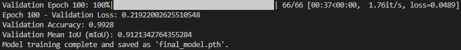
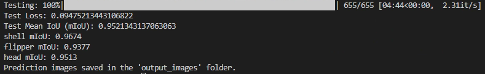
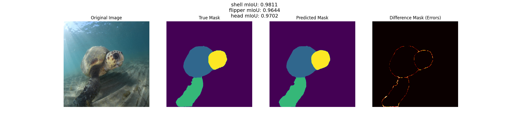
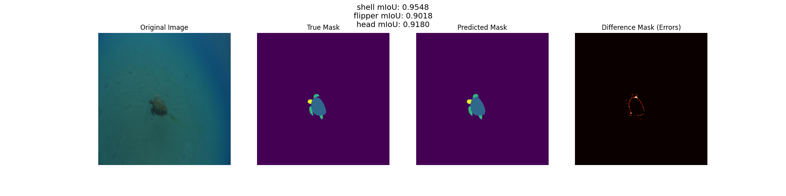

# COMP9517 Computer Vision 24T3
# Project ：Turtle Segmentation Project 🐢

## 👥 Team: the avenger 🖤
🖤 Yining Liu z5466010

## Table of Contents

- [Overview](#Overview)
- [My Contribution](#my-contribution)
- [MODEL](#model)
  - [Unet_Improved_Miou](#unet_improved_miou)
    - [Environment Setup](#environment-setup)
    - [How to Run](#how-to-run)
      - [Testing](#testing)
      - [Training](#training)
    - [Evaluation](#evaluation)
      - [UNet Training Result](#unet-training-result)
      - [UNet Testing Result](#unet-testing-result)
      - [UNet Example-output](#unet-example-output)
    - [Contributor](#contributor)[](#deeplabv3-contributor)          

## Overview

The Turtle Segmentation Project aims to implement semantic segmentation on turtle images, focusing on identifying and differentiating key anatomical parts such as the head, flippers, and shell. This segmentation task is critical for monitoring and studying turtles, as well as supporting research and conservation efforts. This project uses semantic segmentation to identify sea turtle parts in underwater images: carapace (shell), flippers, and head. It uses the SeaTurtleID2022 dataset and COCO-format annotations.

This repository focuses on my individual contribution: an improved U-Net model with a ResNet50 encoder, implemented with `segmentation_models_pytorch`.

## My contribution

- Implemented the U-Net with an ImageNet-pretrained ResNet50 encoder.
- Built the dataset pipeline to load images and construct segmentation masks from COCO annotations.
- Combined class-weighted cross-entropy and Dice losses to train the multi-class segmentation model.
- Implemented training and evaluation workflows, including mean IoU and per-class IoU calculations.
- Generated prediction visualisations for comparing images, ground-truth masks, and model predictions.

The model was compared with another U-Net implementation in the team project. The project README reports a higher mIoU for this implementation.

## MODEL 

### Unet_Improved_Miou
`Unet` is a popular architecture for image segmentation. 
This Unet model has a higher mIoU compared to another Unet model in this group. 
This Unet model is implemented using the segmentation_models_pytorch library and is optimized for the sea turtle segmentation task. The sections below outline the required environment setup, how to run the code, and the evaluation results for this model.

#### Environment Setup

Before running the code, please ensure the following dependencies are installed:

- Python 3.7+
- PyTorch
- segmentation_models_pytorch
- torchvision
- tqdm
- pandas
- scikit-learn
- matplotlib
- pycocotools

Install these dependencies with the following command:

```bash
pip install torch torchvision segmentation-models-pytorch tqdm pandas scikit-learn matplotlib pycocotools
```

Or install dependencies
   ```bash
   pip3 install -r requirements.txt
   ```

#### How to Run
##### Because pre-trained model is so large over 100MB. I upload it to google drive.
##### Please! Please! Please!
##### Download [pre-trained model](https://drive.google.com/file/d/1ViYOYjBqGGWS6Ojrj2QwRpgUehWpf_S2/view?usp=sharing) first.
##### And put it in folder named TurtleUnet. 

##### Testing

Check the image and metadata_splits pathes in test and evaluate, then run:

```
python evaluate.py
```

##### Training

To train the model, you need to first prepare our [Turtle dataset](https://drive.google.com/drive/folders/1dQZ52oFaJk2JWWjI7o3xMJBUsMXf2H6e?usp=drive_link), and metadata_splits.csv file [metadata_splits.csv](https://drive.google.com/file/d/1OpMF-e619qX1qpqtxhLb_A9e1nCA-lJI/view?usp=sharing).

Check the image and metadata_splits pathes in test and evaluate, then run:
```
python train.py
```

#### Evaluation

Below is an example of the model's predicted outputs, showing the original image, true mask (ground truth), predicted mask by the model, and a difference mask that highlights the errors.

#### UNet Training Result



#### UNet Testing Result



#### UNet Example-output 




In these examples:
- **Original Image**: The raw image from the dataset.
- **True Mask**: The ground truth segmentation mask, where each color represents a different part of the turtle (yellow for the head, green for flippers, and blue for the shell).
- **Predicted Mask**: The segmentation mask predicted by the model. The model has accurately identified the main parts of the turtle.
- **Difference Mask (Errors)**: Shows the areas where the predicted mask differs from the true mask. The red outlines indicate areas where the model's predictions did not perfectly align with the ground truth.

#### Contributor
🖤 Yining Liu z5466010